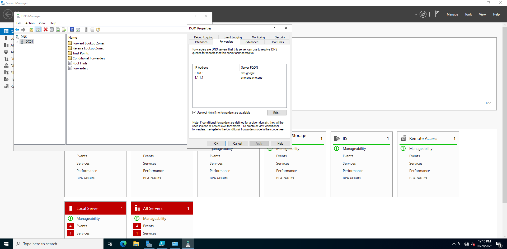
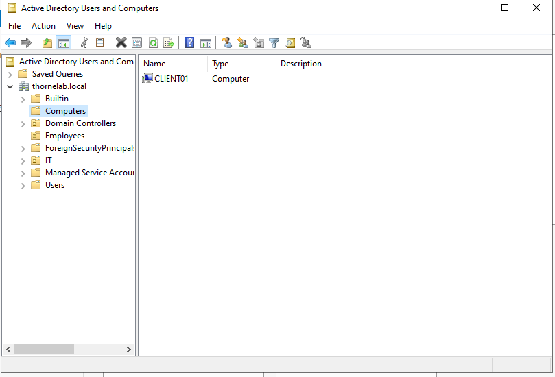
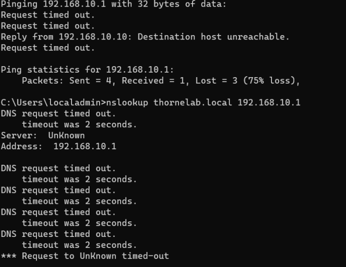

# Active Directory Home Lab

A Windows Server 2022 domain built from scratch in VirtualBox. The domain controller runs AD DS, DNS, DHCP, and RRAS/NAT on an isolated virtual network, and a PowerShell script provisions 5 department OUs, a security group per department, and 150 users.

This is my second build. The first one (documented further down) covered a client domain join and Group Policy. I rebuilt it from a clean install to add the services a real small office network depends on: clients getting addresses from DHCP, reaching the internet through the server, and accounts created in bulk instead of one at a time.

## Environment

| Machine | Role | OS | Network |
|---|---|---|---|
| DC01 | Domain controller, DNS, DHCP, RRAS/NAT | Windows Server 2022 Standard Evaluation (Desktop Experience) | `_INTERNAL`: 172.16.0.1/24 (static) on VirtualBox Internal Network `corpnet`<br>`_INTERNET`: VirtualBox NAT (10.0.2.15) |

| Setting | Value |
|---|---|
| Domain | `thornecorp.local` (NetBIOS `THORNECORP`) |
| DHCP scope | 172.16.0.100 to 172.16.0.200, router and DNS 172.16.0.1 |
| DNS forwarders | 8.8.8.8, 1.1.1.1 |
| Admin account | `a-aaron` (Domain Admins), separate from the built-in Administrator |
| OUs | IT, HR, Finance, Sales, Operations |


## What I Built

**Two adapters, on purpose.** DC01 has one adapter on an isolated internal network for the domain and one on VirtualBox NAT for internet access. I renamed them `_INTERNAL` and `_INTERNET` before doing anything else, because nearly every later step (DNS registration, NAT, DHCP) depends on picking the right one. Most of the problems below came from the NAT adapter's address ending up somewhere it shouldn't.

**Domain controller.** Set a static IP on `_INTERNAL` with DNS pointing at itself, renamed the server, installed AD DS, and promoted it as the first DC of a new forest. I then created `a-aaron` as a separate Domain Admin and did the rest of the build from that account, which is how admin access is normally handled instead of working from the built-in Administrator.

**DNS forwarders.** Added 8.8.8.8 and 1.1.1.1 as forwarders so the domain's DNS server can resolve outside names for clients.



**NAT with RRAS.** Installed the Remote Access role with Routing, then configured NAT with `_INTERNET` as the public interface. Clients on `corpnet` have no route to the internet on their own; DC01 translates their outbound traffic out the NAT adapter.


**DHCP.** Installed the DHCP role, authorized the server in Active Directory, and created a scope for 172.16.0.100 to .200. The scope hands clients the DC as both their gateway (option 3) and DNS server (option 6), which is what lets a client find the domain and reach the internet without any manual configuration.

```
PS> Get-DhcpServerInDC
IPAddress    DnsName
---------    -------
172.16.0.1   dc01.thornecorp.local

PS> Get-DhcpServerv4OptionValue -ScopeId 172.16.0.0
OptionId Name            Value
-------- ----            -----
51       Lease           {691200}
3        Router          {172.16.0.1}
15       DNS Domain Name {thornecorp.local}
6        DNS Servers     {172.16.0.1}
```

**Bulk provisioning with PowerShell.** [`Create-LabUsers.ps1`](Create-LabUsers.ps1) creates the 5 department OUs, a `<Dept>-Users` security group in each, and 150 users (15 first names by 10 last names, so every name is unique). It uses `$i % 5` to spread users evenly so each OU gets exactly 30, adds each user to their department group, and checks whether each OU, group, and user already exists before creating it, so it can be rerun safely. It finishes by counting users per OU with `-SearchBase` as a built-in check.


## Problems I Hit and How I Fixed Them

**The domain resolved to the NAT address.** After promotion, `nslookup thornecorp.local` returned `10.0.2.15` alongside `172.16.0.1`. A client on `corpnet` can't reach 10.0.2.15, so any client that got that answer would fail to find the domain controller and fail to join. I had unchecked "Register this connection's addresses in DNS" on `_INTERNET` in the GUI, but checking with PowerShell showed the setting had never saved:

```powershell
Get-DnsClient -InterfaceAlias "_INTERNET" | Select InterfaceAlias, RegisterThisConnectionsAddress
# RegisterThisConnectionsAddress : True
```

The fix was to turn registration off from PowerShell, make the DNS server listen only on the internal IP, delete the bad records, and have Netlogon re-register the DC's records:

```powershell
Set-DnsClient -InterfaceAlias "_INTERNET" -RegisterThisConnectionsAddress $false
dnscmd /ResetListenAddresses 172.16.0.1
Restart-Service DNS
Get-DnsServerResourceRecord -ZoneName thornecorp.local -RRType A |
  Where-Object {$_.RecordData.IPv4Address -eq "10.0.2.15"} |
  Remove-DnsServerResourceRecord -ZoneName thornecorp.local -Force
ipconfig /flushdns
Restart-Service Netlogon
```

Afterward, both `thornecorp.local` and `dc01.thornecorp.local` resolved to 172.16.0.1 only. The lesson I took from it: on a multihomed server, verify a setting from the command line instead of trusting that a dialog box saved it.

**DHCP was handing out the NAT address as a DNS server.** Checking the new scope's options showed option 6 set to `{10.0.2.15, 172.16.0.1}`. The scope wizard had auto-filled every IP on the server, with the unreachable NAT address listed first, so clients would have tried it before the real DNS server. Same root cause as the first problem, in a different place. I set it to the internal address only:

```powershell
Set-DhcpServerv4OptionValue -ScopeId 172.16.0.0 -DnsServer 172.16.0.1 -Force
```

**Promotion copied my home router in as a DNS forwarder.** The forwarders list had `192.168.1.1` (my home router) above 8.8.8.8 and 1.1.1.1. The promotion picked it up from the NAT adapter's DNS settings. It worked, but it tied the lab to my home network and would slow lookups anywhere else, so I removed it.

**The RRAS NAT wizard showed no interfaces.** The first time through, the "Use this public interface" list was empty and only the demand-dial option was available. Closing the console, disabling Routing and Remote Access, and running the wizard again brought both adapters up so `_INTERNET` could be selected.

**Access denied as a Domain Admin.** `Get-DhcpServerv4OptionValue` failed with PermissionDenied while signed in as `a-aaron`. Being in Domain Admins doesn't bypass UAC; the PowerShell window wasn't elevated. Running it as administrator fixed it.

## First Build: Client Join and Group Policy

The first version of this lab (`thornelab.local`, VirtualBox network `labnet`, static IPs on 192.168.10.0/24) covered the client side: a Windows 11 workstation joined to the domain and a Group Policy Object verified applying to it.

**Domain join.** Gave Client01 a static IP and pointed its DNS at the DC, verified connectivity with `ping` and name resolution with `nslookup` before joining, then joined it with domain admin credentials. The computer object appeared in the Computers container and `whoami` returned the domain account.



**Group Policy.** Created `Desktop-Standard-Policy`, linked it to the `Employees` OU, and configured a User Configuration setting (Remove Change Password, under Ctrl+Alt+Del Options). I also set a domain account lockout policy, then practiced the help desk side of it: resetting passwords and clearing lockouts in ADUC and PowerShell, and connecting to the client over RDP. `gpresult /r` on the client confirmed the policy applied and was pulled from the DC.


**Problems from the first build:**

- **Client couldn't reach the DC.** Ping returned "Destination host unreachable" from the client's own IP, meaning its ARP request for the DC got no answer. That pointed at layer 2, not DNS or a firewall. The client's adapter had never saved to Internal Network; reapplying it with the VM fully powered off fixed it.

  

- **Domain option greyed out.** `winver` showed Windows 11 Home, which can't join a domain. Upgrading in place to Pro enabled the join. This is a common real-world reason a join fails.
- **Windows 11 setup demanded a Microsoft account** on an isolated network. `start ms-cxh:localonly` from a command prompt during setup allowed a local account.
- **nslookup showed "Server: UnKnown."** Cosmetic: nslookup does a reverse lookup on the DNS server to print its name, and no reverse lookup zone existed.

## What This Covers

- Installing and configuring AD DS, DNS, DHCP, and RRAS/NAT on Windows Server 2022
- DHCP scopes, scope options, and authorizing a DHCP server in Active Directory
- DNS forwarders and record cleanup on a multihomed server
- Creating OUs, security groups, and users in bulk with PowerShell, and managing them in ADUC
- Joining workstations to a domain and troubleshooting joins that fail
- Creating, linking, and verifying Group Policy Objects with `gpupdate` and `gpresult`
- Network troubleshooting with `ipconfig`, `ping`, `nslookup`, `arp`, and PowerShell cmdlets

## Next Steps

- Build CLIENT01 on `corpnet`, confirm it pulls a DHCP lease and reaches the internet through NAT, and join it to `thornecorp.local`
- Link OU-specific GPOs (block removable storage for Finance, restrict Control Panel for Sales) and verify them per user with `gpresult`
- Run help desk drills against the new users: password resets, account disables, and moving a user between departments
- Add a reverse lookup zone for 172.16.0.0/24
