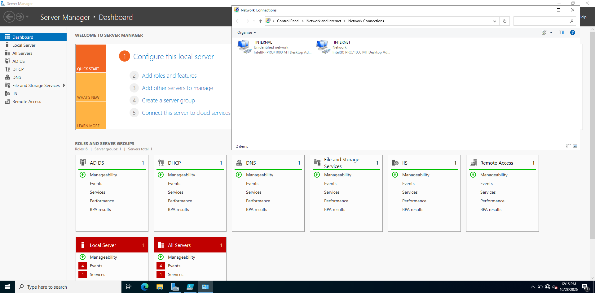
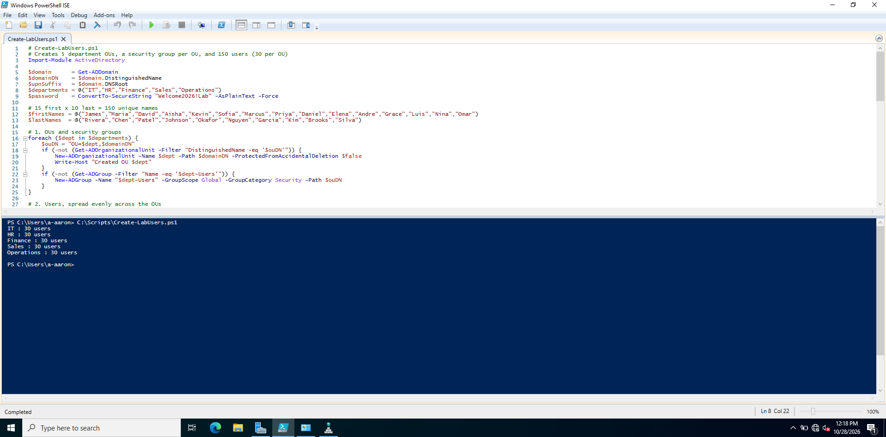
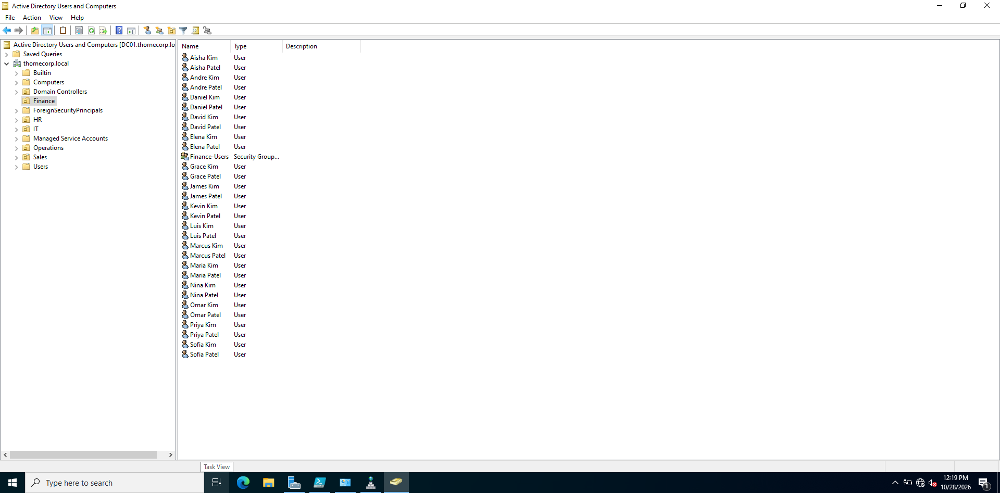
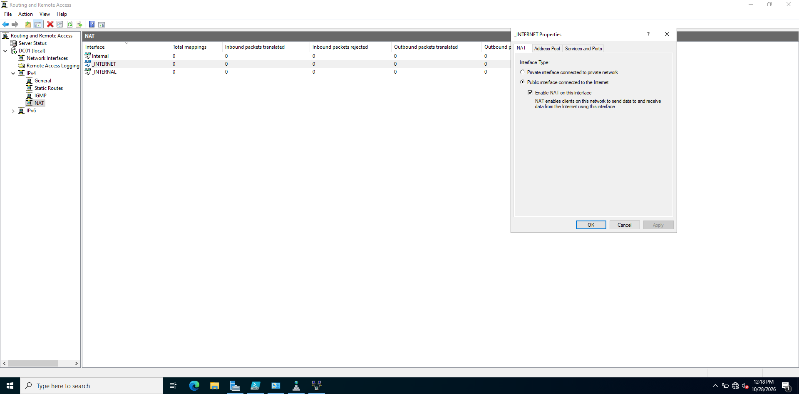
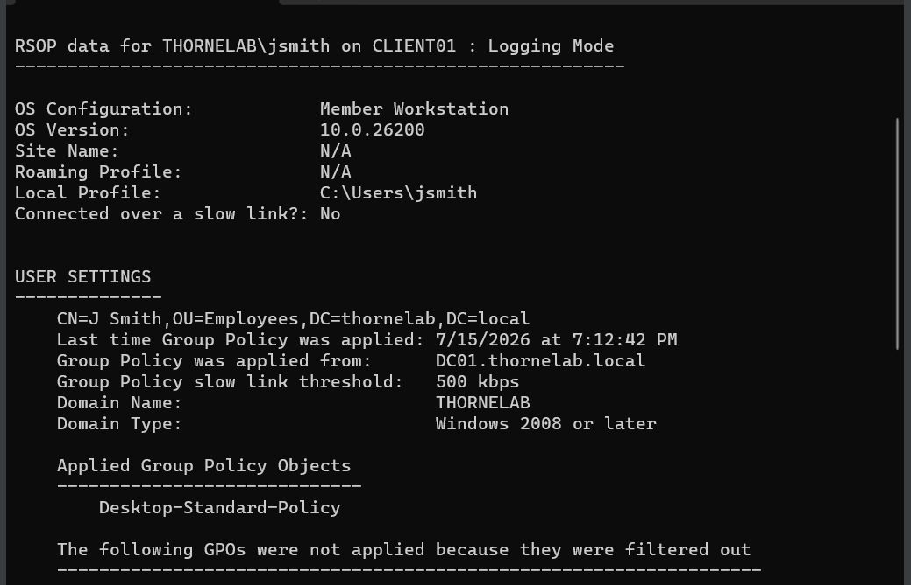

# Active Directory Home Lab

A Windows Server 2022 domain built from scratch in VirtualBox to practice the day-to-day work of a help desk and desktop support role.

## What I Built

- **Domain controller** running AD DS and DNS for `thornecorp.local`
- **DHCP** scope that gives clients an IP, gateway, and DNS server automatically
- **NAT routing (RRAS)** so clients on the isolated lab network can reach the internet through the server
- **PowerShell script** that creates 5 department OUs, a security group for each, and 150 users ([`Create-LabUsers.ps1`](Create-LabUsers.ps1))
- **Domain-joined Windows 11 client** with Group Policy and an account lockout policy, verified with `gpresult`
- **Help desk tasks:** password resets, account unlocks, and remote access over RDP

| Machine | Role | Network |
|---|---|---|
| DC01 | Windows Server 2022: AD DS, DNS, DHCP, RRAS/NAT | Internal 172.16.0.1, plus a NAT adapter for internet |
| Client | Windows 11, domain-joined | Internal network |

## Screenshots

**Server roles and the two network adapters**

**150 users created by script, 30 per department**

**Department OUs with users and security group**

**NAT configured on the internet-facing adapter**

**Group Policy applied on the domain-joined client**

## Problems I Solved

| Problem | Cause | Fix |
|---|---|---|
| Domain name resolved to an unreachable IP (10.0.2.15) | Server registered its NAT adapter in DNS; the GUI setting to stop it never saved | Disabled registration in PowerShell, limited DNS to the internal IP, deleted the bad records |
| DHCP handed clients the wrong DNS server | Scope wizard auto-filled the NAT address | Set the scope's DNS option to the internal IP only |
| Client couldn't reach the DC | VM network adapter setting never saved; found via "Destination host unreachable" (ARP failure) | Reapplied the adapter setting with the VM powered off |
| Client couldn't join the domain | Windows 11 Home doesn't support domain joins | Upgraded in place to Windows 11 Pro |

## Skills

Active Directory, Group Policy, DNS, DHCP, NAT/routing, PowerShell, Windows Server 2022, Windows 11, `ipconfig`, `nslookup`, `ping`, `gpresult`, RDP
